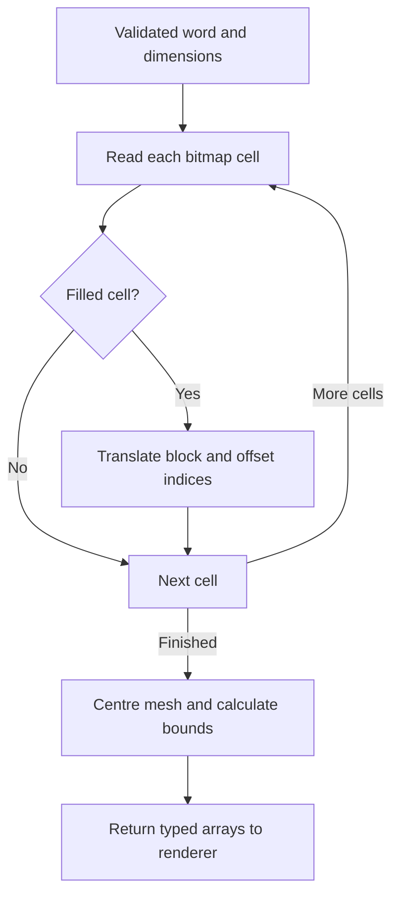

# M1 implementation and handoff

## Run the work

Open `test/geometry-test.html` in a WebGL-capable browser. No server or dependencies
are required for this classic-script demo. The production `index.html` remains a
team integration task. Run the numerical checks from `CPC354-Assignment-1`:

```sh
node --test test/geometry.test.cjs
```

## Implementation order and responsibilities

1. `src/geometry/font.js`: 26 uppercase A-Z glyphs, each seven rows of five cells.
2. `src/geometry/cube.js`: build a centred rectangular prism with independent depth,
   outward normals, counterclockwise triangles, and face metadata.
3. `src/geometry/word.js`: validate input, place a block at every filled bitmap cell,
   offset triangle indices, combine letters, centre the occupied bounds, and return
   typed arrays. No DOM or GPU state is changed by these functions.
4. `test/geometry.test.cjs`: verify mesh structure, winding, all glyphs, dimensions,
   centring, determinism, and invalid/boundary inputs.
5. `test/geometry-test.html` and `geometry-preview.js`: diagnostic adapter for
   rotating and viewing the mesh with back-face culling. This is not the required
   TV-ident sequence and does not replace M2/M3/M5 production implementations.

## Proposed interface (team review still needed)

The contracts below are implementation choices, not agreements already obtained
from teammates. Load scripts in this order, matching the current classic-script
animation architecture:

```html
<script src="src/geometry/font.js"></script>
<script src="src/geometry/cube.js"></script>
<script src="src/geometry/word.js"></script>
```

```js
const mesh = buildWordGeometry({
    word: 'USM', blockSize: 1, letterSpacing: 1, extrusionDepth: 1
});
```

Defaults are shown above. Text is trimmed and ASCII lowercase is converted to
uppercase. Support is 2-4 letters A-Z (use 3-4 for the main demonstration).
Unsupported characters, internal spaces, and invalid lengths throw descriptive
errors. Block size and extrusion depth accept finite numbers from 0.01 to 100;
spacing accepts 0 to 100, all in world units. These bounds avoid degenerate
geometry and extreme numerical inputs. Strings are not coerced to numbers.

| Field | Format | Meaning / consumer |
| --- | --- | --- |
| positions | Float32Array, 3 per vertex | x/y/z, centred object space; M2 uses attribute size 3 |
| normals | Float32Array, 3 per vertex | Unit outward normals in object space; M2 transforms for lighting |
| indices | Uint16Array | Indexed triangles; M2 draws with UNSIGNED_SHORT |
| faceIds | Uint8Array, 1 per vertex | 0 front (+Z), 1 back (-Z), 2 top (+Y), 3 bottom (-Y), 4 right (+X), 5 left (-X) |
| letterIds | Uint8Array, 1 per vertex | Zero-based character index for M5's palette mapping |
| bounds | object | min, max, size, center: each an [x,y,z] array; M3 uses for framing |
| word | string | Normalized word |
| blockCount | number | Number of occupied bitmap cells |
| parameters | object | Normalized inputs used to create this mesh |

No final colour buffer is supplied: M5 can map metadata to a palette; M2 uploads
the resulting RGB/RGBA values. The diagnostic demo uses RGB. Positions use three
components, unlike references that may use homogeneous vec4 positions. M2 can
construct `vec4(aPosition, 1.0)` in the shader.

With four letters, even a completely filled font has only 140 blocks and 3,360
vertex records, comfortably below the Uint16 limit. Each block has 24 records,
36 indices and 12 triangles. Eight corner locations are repeated across faces
because each hard edge needs separate normals. Internal shared block faces are
retained for clarity; hidden-face removal is a possible later optimisation.

## Geometry mathematics for the report

The coordinate system is X right, Y up, Z towards the front. For block width b
and depth d, corners use x/y = +/-b/2 and z = +/-d/2. A quad becomes triangles
(0,1,2) and (0,2,3); the cross product of their edge vectors points outward.

For letter index i, row r and column c:

```text
block centre x = i * (5*b + spacing) + c*b
block centre y = (6-r) * b
block centre z = 0
```

Rows increase downward in the bitmap, so (6-r) flips them into the Y-up system.
Spacing is between five-column glyph boxes; glyphs with unused outer columns
can have a larger visible gap. Neighbouring occupied cells within a letter touch.

Before appending a block, save `vertexOffset = positions.length / 3`.
Add that offset to every local block index. This prevents triangles from pointing
back to earlier blocks. Translation leaves the block's normals unchanged.

For each axis, find the minimum and maximum occupied vertex coordinates. Subtract
`(min + max) / 2` from every vertex on that axis. Bounds are recomputed from the
final Float32Array, so they describe the actual data M2 uploads. Size is max-min.
M3 should consider these dimensions plus rotation/hover margins when framing;
M4 can rotate about the origin without making the word orbit an unrelated point.



The flowchart shows that only filled cells emit geometry. A block is reused as a
template, but its translated vertex records are appended for each filled cell.
Centring happens once after all letters have been assembled.

## Integration checklist

- M2: upload positions/normals/indices; use three-component attributes, depth
  testing, consistent front-face winding, and an appropriate normal transform.
- M3: use `bounds.size`, near/far planes, and motion margins for fitting. The
  diagnostic preview uses a bounding sphere and orthographic projection only.
- M4: consume the centred geometry with existing model transforms. The planned
  scale-down sequence issue remains outside M1's edits.
- M5: parse numeric controls, call the builder in a try/catch, display its error,
  and preserve the previous valid mesh on failure. Colours use metadata.
- Main integrator: build once at startup; rebuild/upload only when word, block
  size, extrusion or spacing changes. Camera/speed changes do not rebuild meshes.
- Everyone: agree these interfaces and verify them in the actual application.

The geometry demo's object-space diagnostic lighting and colour palette are not
production shading. Geometry is fitted after changes, so compare dimension readouts
as well as apparent on-screen size. Back-face culling makes wrong winding visible.

## M1 explanation / video outline (under five minutes)

1. Show the default word and change extrusion, spacing and block size.
2. Explain one bitmap cell and the six block faces in font.js/cube.js.
3. Explain the index offset and centring code in word.js.
4. Rotate to the back, try invalid input, and show the automated checks.
5. Explain the handoff to the renderer, camera and palette modules.

Do not claim authorship or independent understanding merely because the code is
in M1's folder. Review and explain the implementation and record your own changes.

## Verification performed in this implementation session

- All six Node test groups passed, covering every A-Z glyph and boundary inputs.
- JavaScript syntax and Git whitespace checks passed.
- Browser rendering was not verified in the execution environment: Playwright's
  browser executable was absent and the browser download failed. The demo still
  needs a real-browser visual check (front/back faces, slider updates, invalid
  input retention, colour modes and resizing) before claiming visual completion.
